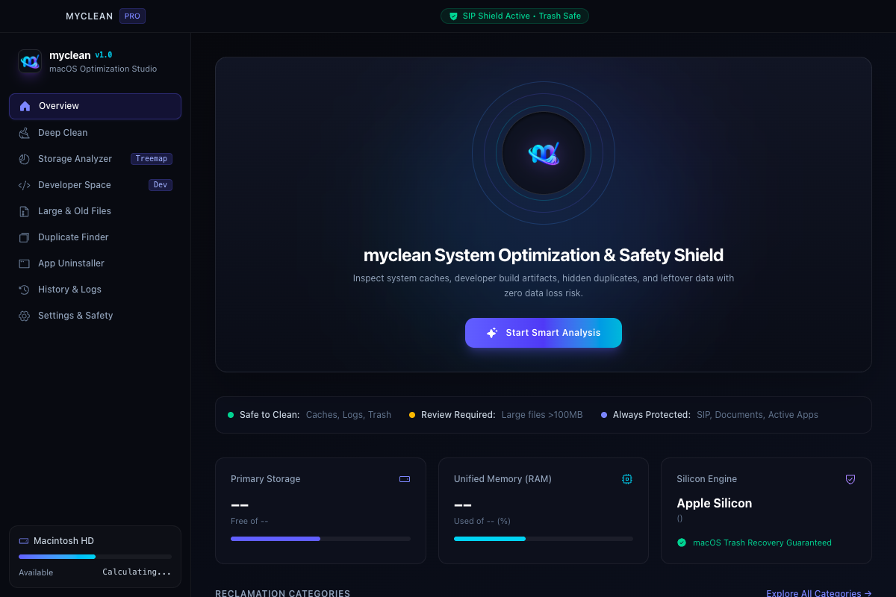

<div align="center">
  

  # myclean

  **Modern, privacy-first macOS cleaner and optimization studio built with Rust and Tauri.**

  Clean application caches, analyze disk storage, detect duplicate files, remove orphaned application data, and prune Docker clutter safely.

  <p>
    <a href="https://github.com/gupywant/myclean/releases/latest">
      
    </a>
    
    
    
  </p>

  <p>
    <a href="https://github.com/gupywant/myclean/releases/latest/download/myclean-1.0.0-universal.dmg">
      <b>Download for macOS (Universal DMG)</b>
    </a>
    &nbsp;•&nbsp;
    <a href="https://github.com/gupywant/myclean/releases">All Releases</a>
    &nbsp;•&nbsp;
    <a href="INSTALL_MACOS.md">Installation Guide</a>
  </p>

  <br />

  
</div>

<br />

---

## Overview

**myclean** is an open-source desktop application designed to inspect, analyze, and recover disk space on macOS without risking data loss. It combines a systems-level Rust scanning core with a fluid interface built on Tauri v2 and React.

Unlike traditional cleaning utilities, myclean is engineered around **non-destructive, recoverable deletion** and **strict filesystem boundaries**. Every file removed by the cleaner is routed directly to the macOS Trash, and core system directories protected by System Integrity Protection (SIP) are hard-excluded at the engine level.

---

## Architecture & Compatibility

myclean is compiled as a native **Universal 2 Mach-O binary** containing both 64-bit architectures:

- **Apple Silicon (`arm64`):** Runs natively on M1, M2, M3, and M4 Macs without Rosetta translation.
- **Intel (`x86_64`):** Runs natively on 64-bit Intel-based Mac hardware.
- **Supported Versions:** macOS 11.0 (Big Sur), macOS 12 (Monterey), macOS 13 (Ventura), macOS 14 (Sonoma), and macOS 15 (Sequoia).

---

## Core Capabilities

### 1. Deep System Scanner
- Identifies disposable user caches, browser caches, outdated application logs, crash reports, and system temporary files.
- Employs conservative classification rules; unrecognized files require explicit manual review and are never selected automatically.
- Parallel directory traversal powered by Rayon with sub-millisecond atomic cancellation.

### 2. Interactive Storage Analyzer
- Dynamic filesystem tree scanner with visual storage breakdown by MIME categories and file extensions.
- Breadcrumb navigation and large file discovery with configurable size thresholds.

### 3. Duplicate File Finder
- Multi-tier duplicate detection: initial file size bucketing, partial BLAKE3 prefix/suffix hashing, and full streaming verification.
- Hard-link and symlink awareness preventing redundant processing or false positives.
- Preserves original files based on user-selected criteria (newest, oldest, or manual selection).

### 4. Application Uninstaller & Remnant Cleaner
- Discovers installed applications across `/Applications` and `~/Applications`.
- Inspects deep remnant locations including `~/Library/Application Support`, `~/Library/Caches`, `~/Library/Containers`, and `~/Library/Preferences`.
- Detects active running processes before uninstalling and blocks removal of Apple system components.

### 5. Developer & Docker Optimization
- Targeted cleanup providers for Xcode DerivedData, Homebrew cache, Cargo registry, npm cache, pnpm store, Yarn cache, and Gradle caches.
- Optional project-level `node_modules` cleanup (requires verified `package.json` manifest).
- Direct Docker daemon integration via `/var/run/docker.sock` to inspect and safely prune stopped containers, dangling images, and build caches. Docker volumes remain strictly protected.

### 6. Audit Logging & Settings
- Comprehensive local SQLite audit log capturing timestamps, item counts, paths, and freed byte estimations with CSV/JSON export.
- Configurable custom exclusion paths, scan scopes, disk threshold warnings, and theme accents.

---

## Safety & Privacy Principles

- **Zero Telemetry:** The application makes zero network requests, contains no analytics SDKs, and does not phone home.
- **Recoverable Deletion:** All cleaning operations route files to the macOS Trash via the native `trash` crate (`trash::delete`). *Note: moving files to the Trash moves them to the user's `.Trash` folder; physical disk space is released once the Trash is emptied by the user.*
- **System Integrity Protection (SIP) Guardrail:** SIP roots (`/System`, `/usr`, `/bin`, `/sbin`, `/Library/Apple`, `/private/var`), user documents (`~/Documents`, `~/Desktop`, `~/Pictures`), and identity stores (`~/Library/Keychains`, `~/Library/Messages`) are strictly guarded in Rust and rejected from scan scopes.
- **Anti-TOCTOU & Symlink Mitigation:** Captures device ID, inode, and symlink metadata snapshots prior to deletion. Any path mutation or symlink replacement aborts execution immediately.
- **Git Repository Safety:** Active Git repositories (`.git/objects`, `.git/refs`) are strictly preserved.

---

## Tech Stack

| Component | Technology | Rationale |
| :--- | :--- | :--- |
| **Desktop Shell** | [Tauri v2](https://tauri.app/) | Low memory footprint, native WebKit webview, secure IPC bridge |
| **Systems Engine** | [Rust 2021](https://www.rust-lang.org/) | Memory safety, zero-cost abstractions, multithreaded scanning |
| **Parallel Traversal** | [Rayon](https://github.com/rayon-rs/rayon), `walkdir` | Multi-core parallel disk indexing with atomic cancellation |
| **Cryptographic Hashing** | [BLAKE3](https://github.com/BLAKE3-team/BLAKE3) | Ultra-fast content hashing with bounded 64 KB streaming buffers |
| **Safe Deletion** | [trash-rs](https://github.com/Byron/trash-rs) | Native macOS Trash integration |
| **Local Persistence** | [SQLite](https://www.sqlite.org/) (`rusqlite`) | Zero-configuration local database for settings and audit history |
| **Frontend Framework** | [React 19](https://react.dev/) + [TypeScript](https://www.typescriptlang.org/) | Type-safe declarative interface |
| **Build & Styling** | [Vite 6](https://vitejs.dev/) + [Tailwind CSS v4](https://tailwindcss.com/) | Route-level code splitting, optimized chunk bundles |
| **Icons & Motion** | [Phosphor Icons](https://phosphoricons.com/), [Motion](https://motion.dev/) | Consistent iconography and spring animation transitions |

---

## Installation

### Download Pre-built Release
Download the latest disk image from the [GitHub Releases](https://github.com/gupywant/myclean/releases/latest) page:

- **Universal:** [`myclean-1.0.0-universal.dmg`](https://github.com/gupywant/myclean/releases/latest/download/myclean-1.0.0-universal.dmg) *(Recommended for all Macs)*
- **Apple Silicon:** [`myclean-1.0.0-aarch64.dmg`](https://github.com/gupywant/myclean/releases/latest/download/myclean-1.0.0-aarch64.dmg)
- **Intel:** [`myclean-1.0.0-x86_64.dmg`](https://github.com/gupywant/myclean/releases/latest/download/myclean-1.0.0-x86_64.dmg)

Drag `myclean.app` into your `/Applications` folder.

### macOS Gatekeeper Note (Ad-Hoc Signing)

> [!IMPORTANT]
> myclean is free, independent open-source software and is distributed **without a paid Apple Developer ID subscription**. Consequently, release binaries are **ad-hoc signed** and **not notarized** by Apple.

When opening for the first time, macOS Gatekeeper may display a dialog stating:
*"myclean cannot be opened because Apple cannot check it for malicious software."*

**Approved launch methods:**
1. **System Settings:** Open **System Settings > Privacy & Security > Security**, scroll down, and click **Open Anyway** next to the notification for `myclean`.
2. **Context Menu:** In `/Applications`, **right-click** (or `Control`-click) `myclean.app`, select **Open**, and click **Open** in the confirmation dialog.

*Do not run `spctl --master-disable`. You should never disable macOS Gatekeeper globally.*

For full details, review [INSTALL_MACOS.md](INSTALL_MACOS.md).

---

## Building from Source

### Prerequisites
- macOS 11.0 or newer
- [Xcode Command Line Tools](https://developer.apple.com/xcode/resources/): `xcode-select --install`
- [Node.js](https://nodejs.org/) (v20+) and `npm`
- [Rust](https://rustup.rs/) (1.80+) with macOS targets:
  ```bash
  rustup target add aarch64-apple-darwin x86_64-apple-darwin
  ```

### Steps

1. **Clone the repository:**
   ```bash
   git clone https://github.com/gupywant/myclean.git
   cd myclean
   ```

2. **Install frontend dependencies:**
   ```bash
   npm ci
   ```

3. **Run in development mode:**
   ```bash
   npm run tauri dev
   ```

4. **Run test suite & linter:**
   ```bash
   cargo test --manifest-path src-tauri/Cargo.toml
   cargo clippy --manifest-path src-tauri/Cargo.toml -- -D warnings
   npx tsc --noEmit
   ```

5. **Package universal release bundles:**
   ```bash
   npm run package
   ```
   Artifacts and cryptographic checksums will be placed in `release-artifacts/`.

---

## Known Limitations

- **Apple Developer ID Notarization:** Releases are ad-hoc signed and require one-time approval through macOS System Settings or the context menu.
- **Full Disk Access (FDA):** Deep system cache and developer scanning requires optional Full Disk Access permissions in **System Settings > Privacy & Security > Full Disk Access**. Inaccessible directories are skipped gracefully.
- **Docker Integration:** Docker features require a local running Docker daemon with an accessible Unix socket at `/var/run/docker.sock`. Docker volumes are intentionally omitted from automatic cleanup.
- **Trash Deletion:** Deletion moves items to the macOS Trash. Disk space is reclaimed once the user empties the Trash in Finder.

---

## Development Roadmap

- [x] **Phase 01–03:** Core Rust systems engine, interactive storage tree analysis, and safe scopes.
- [x] **Phase 04–06:** Conservative cache cleaner, multi-tier duplicate detection, and app uninstaller.
- [x] **Phase 07–09:** Developer & Docker cleaner, SQLite persistence, and security hardening against TOCTOU.
- [x] **Phase 10:** Universal macOS release packaging and GitHub Actions CI pipeline.
- [x] **Phase 11:** GitHub branding, SEO optimization, real application screenshots, and documentation.
- [ ] **Phase 12:** Homebrew Cask tap (`brew install --cask gupywant/tap/myclean`) and opt-in GitHub Release update notifier.

---

## Contributing

Contributions to myclean are welcome. Please ensure that all submissions:
1. Maintain safety invariants: file deletion must remain routed through the native `trash` crate; permanent removal is prohibited.
2. Adhere to the design system: Futuristic Premium theme utilizing Tailwind CSS v4, Motion for React, and Phosphor Icons exclusively (Lucide is disallowed).
3. Include unit and integration test coverage for all new scanner rules or provider implementations.
4. Pass all verification gates prior to submitting a pull request:
   ```bash
   cargo test --manifest-path src-tauri/Cargo.toml
   cargo clippy --manifest-path src-tauri/Cargo.toml -- -D warnings
   npx tsc --noEmit
   npm run build
   ```

---

## License

This project is licensed under the MIT License — see the [LICENSE](LICENSE) file for details.
